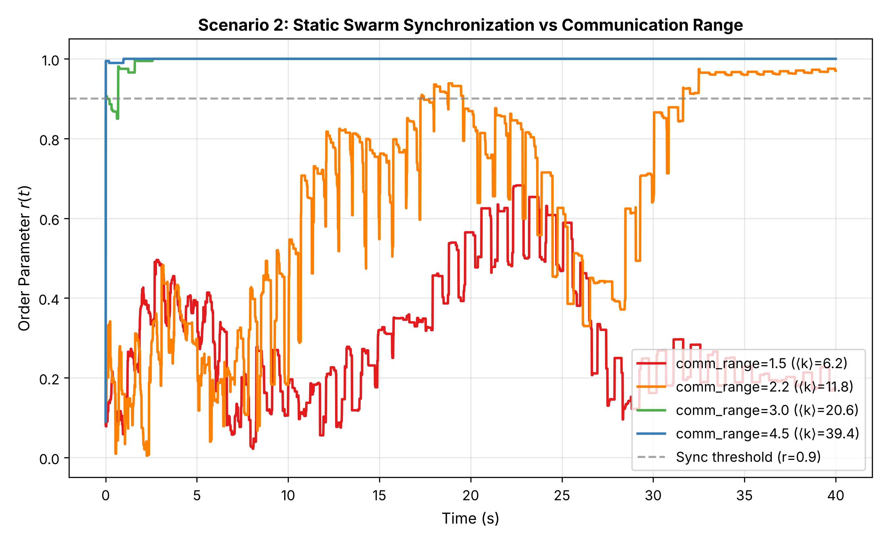
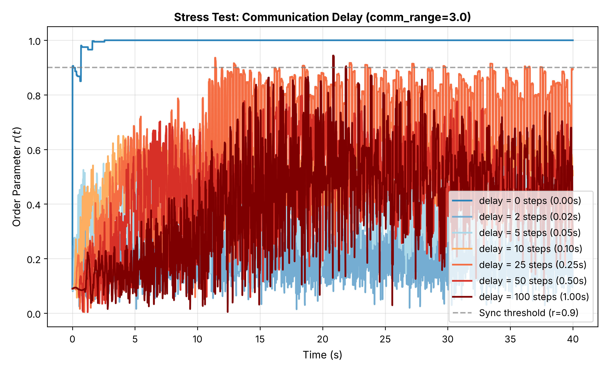
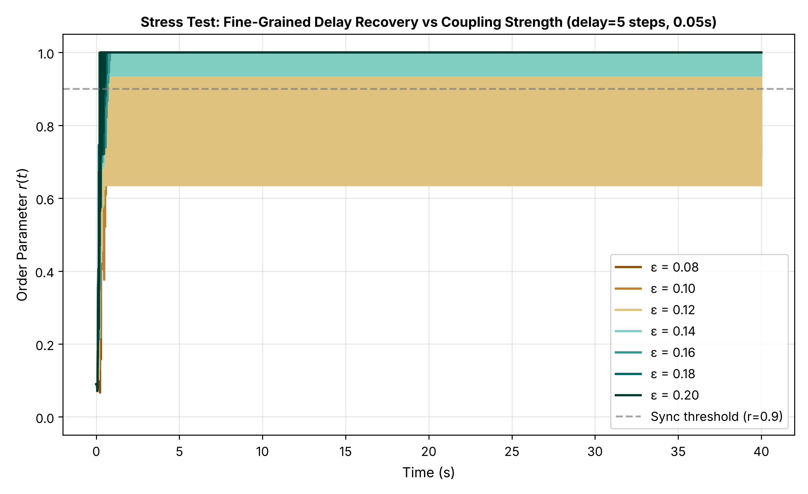

# Cortex Hive

Decentralized clock synchronization for drone swarms with no GPS (Global
Positioning System) and no central controller, using pulse-coupled
spiking oscillators.

## The problem

Most swarm robotics demos assume every agent has a GPS fix or a ground
station broadcasting a master clock. Take that away (jammed, denied, or
just out of range indoors) and a swarm needs some other way to agree on
timing for coordinated maneuvers. Centralized solutions create a single
point of failure: if the lead agent or base station goes down, the whole
swarm loses sync.

Cortex Hive looks at a decentralized alternative: can a swarm synchronize
its internal clocks purely from local, peer-to-peer pulses, the same way
fireflies in a field converge on a shared flashing rhythm with no firefly
in charge?

## Method

Each agent is modeled as a pulse-coupled oscillator following the
Mirollo-Strogatz framework: a phase that charges up through a concave
potential function and fires a pulse when it crosses threshold. When an
agent fires, every neighbor within communication range gets a small
potential bump, which can trigger cascading fires in the same timestep.
Synchrony across the swarm is measured with the Kuramoto order parameter,
`r(t)`, which goes from 0 (incoherent) to 1 (perfectly synchronized).

Three coupling scenarios are simulated:

1. **All-to-all** (`simulate_all_to_all`): every agent can hear every
   other agent. This is the theoretical upper bound, not a realistic
   deployment.
2. **Static decentralized** (`simulate_static`): agents sit at fixed
   random positions, and only agents within `comm_range` of each other
   are connected. This is a random geometric graph.
3. **Mobile decentralized** (`simulate_mobile`): agents move with
   bouncing boundary conditions, and the connectivity graph is
   recomputed periodically as positions change.

On top of the base model, `stress_tests.py` degrades the simulation
along three axes that matter for a real deployment: oscillator frequency
heterogeneity (agents don't have perfectly identical internal clocks),
communication delay (pulses don't arrive instantly), and packet loss
(some pulses never arrive at all). A fine-grained sweep over coupling
strength under fixed delay was also run, across three random seeds, to
check whether a recovery threshold held up or was just noise from a
single run.

## Results

All numbers below come directly from the simulation output in
[`results/`](results/), not hand-typed estimates.

**Baseline synchronization** (N=100 agents, `results/summary_table.txt`):

| Scenario | Avg degree | Final r | Time to r > 0.9 |
|---|---|---|---|
| All-to-all baseline | 99.0 | 1.0000 | 0.02s |
| Static, comm_range=1.5 | 6.2 | 0.1727 | did not reach |
| Static, comm_range=2.2 | 11.8 | 0.9702 | 17.25s |
| Static, comm_range=3.0 | 20.6 | 1.0000 | 0.01s |
| Mobile, speed=1.5 m/s | 12.3 | 1.0000 | 20.38s |

Below a connectivity threshold (comm_range=1.5, average degree 6.2), the
swarm never reaches sync. Above it, sync emerges quickly, confirming the
expected percolation-style behavior of random geometric graphs.


**Degradation stress tests** (`results/stress_summary_table.txt`):

- Frequency heterogeneity up to `sigma_omega = 0.10` still reaches a mean
  r of 0.95 over the final 2 seconds; the model tolerates clock drift
  reasonably well on its own.
- Communication delay is the harshest failure mode: even 2 timesteps of
  delay (0.02s) drops final r to 0.19, and none of the tested delays
  from 2 to 100 steps recover sustained sync at the default coupling
  strength (eps=0.05).
- Packet loss up to 50% barely affects final r (still 1.0000), the
  cascade mechanism is naturally redundant against dropped pulses, but
  70% loss breaks it (final r = 0.3673).
- Raising coupling strength recovers sync under fixed delay: at
  delay=5 steps, sustained r > 0.9 is never reached below eps=0.14, but
  is reached by eps=0.16 and holds through eps=0.20. This threshold was
  checked across three random seeds (42, 101, 2024) in
  `results/delay_recovery_multiseed_table.txt`, and while the exact eps
  where it tips varies a bit by seed, the recovery trend is consistent.
  


Plots for every sweep, plus a GIF of the mobile swarm converging, are in
[`results/`](results/).

## Running it

```bash
pip install -r requirements.txt
python src/firefly_sync.py     # baseline scenarios 1-3, ~2-3 min
python src/stress_tests.py     # degradation sweeps + multi-seed check, ~2-3 min
```

Both scripts write their figures and tables into `results/`, overwriting
what's already there. There's a built-in check:
`stress_tests.py` asserts that zero-degradation output matches the
`firefly_sync.py` baseline to within `1e-12` before running anything
else, so a broken refactor would fail loudly instead of silently
producing wrong numbers.

## Limitations

This is a simulation study, not a hardware validation. The communication
model is an idealized radio (perfect connectivity within a fixed range,
nothing beyond it) rather than real RF propagation. There's no
comparison here against other decentralized timing approaches (consensus
clock synchronization, for instance), so "this works" should not be read
as "this is better than the alternatives." Those are the two biggest
gaps between this and something publication-ready at a research venue.

## Background

Cortex Hive placed 2nd overall at the International Electronics and
Robotics Innovation Competition (ERIC) 2026, Side Connect track, Drone
Innovation sub-track, hosted by Universitas Negeri Jakarta (UNJ), and
won Best Product Design and Best Innovation Concept in the same
competition.

## Team

- Sahad Ahmad
- Syed Rayyan Bukhari
- Aurangzeb Mughal

All three are Aerospace Engineering students at the Institute of Space
Technology (IST), Islamabad.

## License

MIT, see [LICENSE](LICENSE).
